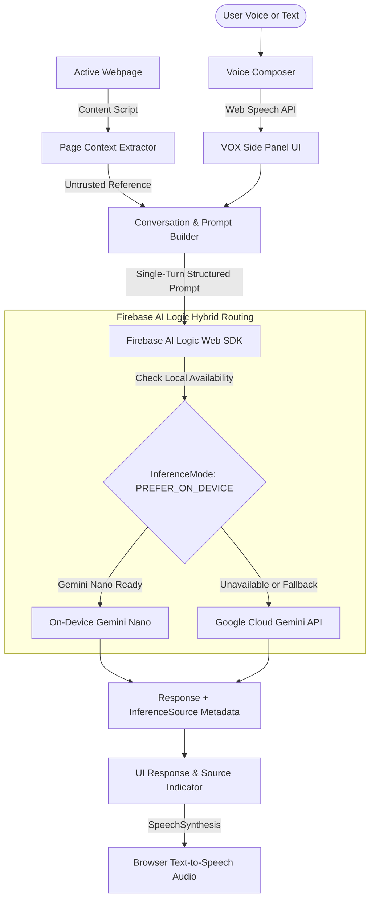

# VOX — Your Voice Companion for the Internet

> **Tagline:** The internet, hands-free.  
> Built for the Google Firebase **#BuildHybridAI** Hackathon 2026.

VOX is a voice-first Chrome extension that turns any webpage into an interactive, spoken learning session. Powered by **Firebase AI Logic Hybrid Inference**, VOX runs AI models locally on your machine via Chrome built-in Gemini Nano when supported, and automatically routes to Google Cloud Gemini when needed.

---

## Architecture Overview



---

## Key Features

1. **Voice-First Conversation**:
   - Push-to-talk microphone capture with live transcription preview and editing.
   - Text input fallback for quiet environments or devices without microphones.
   - Integrated browser Text-to-Speech (TTS) with playback, pause, stop, and replay controls.
2. **Page Grounding ("Teach Me This Page")**:
   - One-click extraction of the active webpage's main readable content.
   - Intelligent DOM cleanup removing ads, menus, headers, and scripts.
   - Secure prompt engineering treating webpage text strictly as untrusted reference material.
3. **Truthful Hybrid Inference Transparency**:
   - Real-time indicator displaying whether the response was generated **On-Device (Gemini Nano)** or via **Cloud Fallback**.
   - Popover explaining the routing decision and execution latency.
4. **Interactive Spoken Learning Actions**:
   - **Teach me this page**: High-level overview and core concepts.
   - **2-minute overview**: Fast spoken summary.
   - **Explain simply**: Concept breakdown in plain language with intuitive analogies.
   - **Key takeaways**: 3–5 bullet points.
   - **Interactive Quiz**: Spoken quiz mode evaluating user answers one question at a time.
   - **Explain Term**: Contextual definition of specific terms selected from the page.
5. **Robust Fallbacks & Edge Cases**:
   - Honest capability strip separating AI, Speech Input, Speech Output, and Network status.
   - Manual text-paste modal when browsing restricted pages (PDFs, `chrome://` URLs, Chrome Web Store).

---

## Firebase AI Logic & App Check Runtime Proof

VOX imports and calls the official modular Firebase Web SDK:

```typescript
import { getAI, getGenerativeModel, GoogleAIBackend, InferenceMode } from 'firebase/ai';

// 1. Initialize Firebase AI Logic
const ai = getAI(firebaseApp, { backend: new GoogleAIBackend() });

// 2. Configure Hybrid Model
const model = getGenerativeModel(ai, {
  model: 'gemini-2.5-flash',
  mode: InferenceMode.PREFER_ON_DEVICE,
});

// 3. Generate & Inspect Source Metadata
const result = await model.generateContent(prompt);
const source = result.response.inferenceSource; // 'ON_DEVICE' | 'IN_CLOUD'
```

See [docs/FIREBASE_IMPLEMENTATION.md](docs/FIREBASE_IMPLEMENTATION.md) for complete technical specifications.

---

## App Check Configuration

Firebase AI Logic requires Firebase App Check:
- **Production**: Configured with ReCaptcha Enterprise / ReCaptcha v3 provider in `src/services/firebase.ts`.
- **Development & Extension**: Set `self.FIREBASE_APPCHECK_DEBUG_TOKEN = true` to output a debug UUID in Chrome DevTools Console. Register this UUID in Firebase Console under **App Check > Manage debug tokens**.

---

## Quick Start & Testing Guide

### 1. Build the Extension
```bash
npm install
npm run build
```
The compiled Manifest V3 extension is output to the `dist/` folder.

### 2. Load Extension in Google Chrome
1. Open Google Chrome and go to `chrome://extensions`.
2. Turn on **Developer mode** (toggle in top-right corner).
3. Click **Load unpacked** (top-left).
4. Select the `dist` folder inside your clone of this repository.
5. Pin VOX to your Chrome toolbar.

### 3. Test with Any Webpage
1. Navigate to any webpage (e.g., an article, tutorial, or Wikipedia).
2. Click the **VOX** extension icon in the toolbar.
3. The VOX companion opens in the **Chrome Side Panel** alongside the webpage.
4. Click **Teach me this page** or tap the **Voice** mic button to ask questions aloud.

---

## Running Automated Tests

Run the test suite (covering sanitization, speech services, prompt isolation, capability detection, and conversation history):

```bash
npm test
```

---

## License

Licensed under the [Apache License, Version 2.0](LICENSE).
